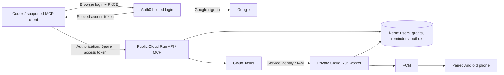

# Production OAuth and multi-user launch

Updated: 2026-10-29. This supersedes the local IAM credential-helper roadmap.

## Recommended architecture

Use **Auth0 as the managed OAuth authorization server, with Google as a sign-in
option**. Keep FastAPI, Neon, Cloud Run, Cloud Tasks and the Android architecture.
Auth0 handles browser login, consent, authorization codes, PKCE and refresh;
AgentPing validates access tokens and enforces user ownership and permissions.
Do not build a custom authorization server or require customer Google Cloud IAM.

The existing private deployment verifies infrastructure and backend execution.
It is not the completed public product. A customer must be able to add the MCP
URL to Codex, sign in and consent in a browser, and access only their own data.
Another user must independently do the same, with refresh and revocation working.
No gcloud, local helper, pasted bearer token or shared account is part of that flow.

The public API must let requests reach OAuth discovery and MCP HTTP 401 challenges.
Replace its customer-facing IAM gate with verified application OAuth after the
implementation passes acceptance tests. Protect all data and tool execution.

Move worker execution to a separate IAM-private Cloud Run service using the same
image. Do not register `/internal/worker/run` on the public API. Split API/worker
identities and grants; only the worker needs FCM send permission. Add an explicit
worker target URL to Cloud Tasks scheduling instead of using the public MCP URL.
Keep Scheduler recovery pointed at the private worker. Both services remain
request-billed with minimum instances zero. No extra gateway, load balancer,
resident worker or hosted database is needed for this design.

## 1. Prove the provider configuration

- Create/use a dedicated Auth0 Free tenant. Verify actual features and quotas after
  trial expiry before depending on them. Never silently upgrade the plan.
- Configure Universal Login and Google social login using our production Google
  OAuth client, external-user consent, exact redirects and required branding/privacy
  configuration. Do not ship developer social credentials or test-users-only login.
- Register the canonical HTTPS `/mcp` resource as the API audience. Enable Auth0's
  resource-parameter compatibility so standard MCP `resource` requests yield the
  intended access-token audience. [Resource compatibility](https://support.auth0.com/center/s/article/mcp-audience-error-with-auth0)
- Use Authorization Code + PKCE S256, explicit delegated consent, short-lived access
  tokens and rotating refresh tokens with expiry/reuse handling. Public Codex/native
  clients must not contain a shared client secret.
- Register separate first-party Android/account-portal clients and keep their owner
  permissions/audiences distinct from third-party MCP agent permissions.
- Prefer verified public-client CIMD registration with token authentication `none`.
  Manual approval of one Codex client can serve many users. An explicitly
  pre-registered public PKCE client is a supported fallback, with nonsecret client
  configuration published. Verify the exact Codex callback and loopback-port rules.
- Do not depend on Auth0's automatic just-in-time CIMD registration for launch:
  its 22 October 2026 release is Early Access. DCR is a reviewed compatibility
  option if required, not the default; the July 2026 MCP spec deprecates it.
  [Auth0 release status](https://auth0.com/changelog),
  [current MCP authorization spec](https://modelcontextprotocol.io/specification/2026-07-28/basic/authorization)
- Verify the actual tenant's browser login, consent, resource binding and refresh
  before changing live invocation policy. Do not assume a generic Google login
  or an advertised issuer makes these flows work automatically.

[Auth0 MCP documentation](https://auth0.com/ai/docs/mcp/overview) and
[CIMD registration](https://auth0.com/docs/get-started/auth0-overview/create-applications/register-applications-with-cimd)
support this choice. Auth0's confidential CIMD `private_key_jwt` is Enterprise-only;
we must use a compatible public-client flow. Token Vault and custom/OBO token
exchange are unnecessary here: MCP tools already call shared backend services.

## 2. Implement strict discovery and token authorization

- Publish protected-resource metadata for the exact MCP URL, pointing to the real
  Auth0 issuer and delegated scopes. Missing/invalid credentials receive HTTP 401
  and a `WWW-Authenticate` resource-metadata challenge. Insufficient permission on
  a valid token must not be confused with a missing login.
- Use standard `Authorization: Bearer <access_token>` for customers. Remove the
  custom production application header and Google CLI owner audience from the
  public configuration. Worker IAM credentials stay server-side.
- Validate signature/algorithm, issuer, audience, expiry, not-before and token/client
  type. Reject ID tokens and wrong-resource tokens. Bound/cache JWKS refresh and
  test signing-key rotation.
- Explicitly distinguish trusted first-party user clients from MCP clients.
  **Missing client identity or missing scopes must never grant owner privileges.**
  The current `None`-client and empty-scope fallbacks require replacement.
- Intersect requested/granted scopes with allowed MCP permissions and the user's
  client grant. MCP access never implies settings/device administration or agent
  management. Critical alerts require separate permission and user opt-in.
- Add focused tests covering discovery, challenges, wrong issuer/audience/token
  type, expired credentials, key rotation, missing/extra scopes and blocked grants.

Relevant code: `auth/oidc.py`, `auth/service.py`, `auth/principal.py`,
`mcp/server.py`, middleware/configuration and production deploy/smoke helpers.

## 3. Finish multi-user identities, grants and onboarding

- Replace the singleton subject allowlist with controlled self-service signup after
  verified login. Create users atomically; support suspension and deletion. Each
  user owns their account, not platform administration or other users' records.
- Store identities by **issuer + subject**, linked to a stable internal user ID.
  Email is profile information. Review the current globally unique email constraint;
  do not merge accounts or select authorization identity by matching email strings.
- Link/migrate the existing Google CLI owner through an explicit verified process,
  preserving internal IDs and data. Back up before migrations; never bulk-reassign
  account ownership by email.
- Store durable user/client grants with consented scopes, status, revocation and
  audit data. Revocation must block already-issued access tokens at AgentPing and
  disable provider refresh as applicable. Provider logout alone is insufficient.
- Add two-user REST/MCP isolation tests for reminders, device targets, pairing,
  sync/cursors, offline actions, settings, activity, client grants and worker delivery.
  Exercise cross-user UUID access, device ownership changes and notification targets.
- Provide a minimal self-service account interface to pair phones and view/revoke
  connected clients. Users must not need developer-issued codes/tokens.

Use Alembic, isolated migration tests and split DDL/DML credentials; recheck grants.
Existing user-scoped service queries provide a foundation, not proof of isolation.

## 4. Deploy and verify the public service

- Prove integration and migrations using isolated non-production data; test separate
  API/worker modes from the same image before cutover.
- Protect database-backed readiness/diagnostics on the public service. Keep anonymous
  liveness cheap and database-free so callers cannot keep Neon awake continuously.
- Add durable per-user/client quotas, abuse controls, bounded task dispatch and
  log redaction. In-process rate limits alone are not a durable public quota.
- Take a fresh backup and verify restore. Deploy the private worker/task target
  first, then the verified application-auth API, then change customer ingress.
  Ensure opening transport never exposes worker/admin execution.
- Test from a machine/profile without our Google Cloud credentials: add URL,
  browser login, consent, initialize tools, create/list, refresh, reconnect, revoke.
  Repeat with a second independent user and demonstrate account isolation.
- Confirm live scheduled work, Scheduler recovery, dead-job handling and denial of
  anonymous protected APIs/public worker calls. Publish supported-client instructions.
- Record actual working revision, migrations and nonsecret provider/client settings;
  prepare rollback that preserves account ownership and authenticated access.

**Release gate:** a clean-machine, two-user browser OAuth journey must pass before
calling public production complete. SDK tests with our Google CLI, pasted tokens
or a local helper do not satisfy this gate.

## 5. Connect Android to the same accounts

Use the managed native login via system browser/PKCE and secure runtime credential
storage. Configure HTTPS, release Firebase/package identity and signing. Each user
pairs their own phone. Verify Codex → MCP → worker → FCM → correct phone, separating
provider acceptance, device receipt, display and audible alarm evidence. Recheck
offline actions, reboot, expiry and revocation. Backend release can precede app
release; end-to-end product availability needs both. Watch work stays deferred.

## Cost and user involvement

Auth0 advertises **$0 for up to 25,000 monthly active users**. Check actual Free
tenant MCP/client limits and feature availability; MAU allowance is not a throughput
or backend capacity guarantee. [Auth0 pricing](https://auth0.com/pricing)

Keep Cloud Run scale-to-zero, Neon Free and event-triggered work. The previous
INR 0–300 estimate covered light private use. Public multi-user usage needs a
fresh workload estimate, abuse limits and measured billing. Target INR 500/month
for a small initial launch; do not promise unlimited users within it. No paid
identity tier, always-on worker, paid minimum instance, Railway or VM changes.

Needed from the user during implementation: Auth0 account/tenant sign-in and
configuration access, Google OAuth consent/branding setup in the owning account,
and browser/phone acceptance testing. Normal customers only sign in and consent;
they never receive Google Cloud IAM roles. Never paste secrets into chat.

## Additional references checked on 2026-10-29

- [OpenAI MCP authentication](https://developers.openai.com/plugins/build/auth)
- [Codex OAuth registration and callbacks](https://learn.chatgpt.com/docs/extend/mcp)
- [Auth0 refresh-token rotation](https://auth0.com/docs/secure/tokens/refresh-tokens/refresh-token-rotation)
- [Cloud Run access control](https://docs.cloud.google.com/run/docs/securing/managing-access)

This is the implementation plan. No provider tenant, production IAM, database
schema or deployment was changed while preparing it.
